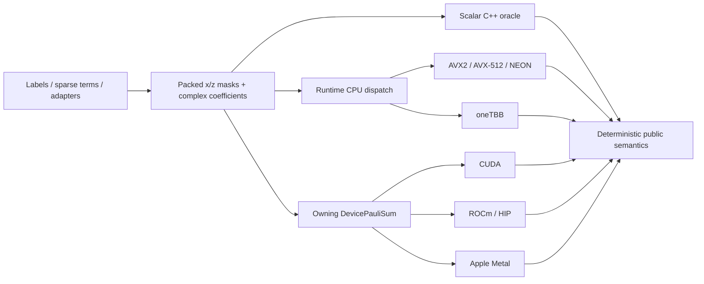
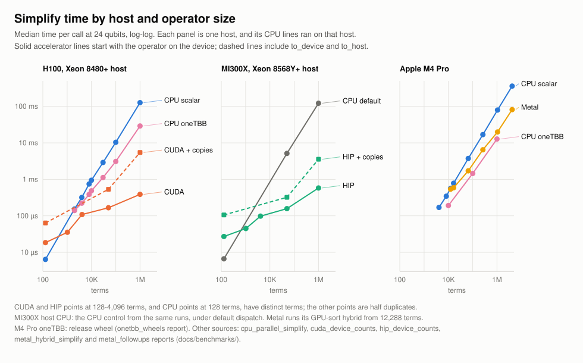
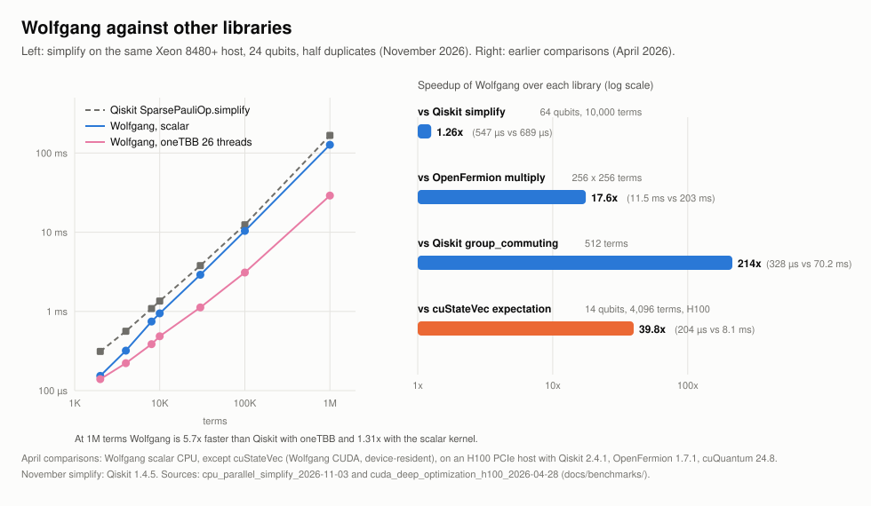
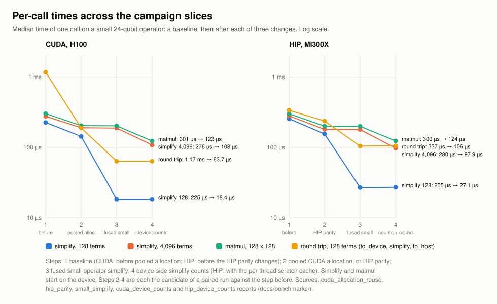

# Wolfgang

<p align="center">
  <strong>Packed Pauli algebra and evidence-driven accelerator kernels.</strong><br>
  C++20 · Python · SIMD · oneTBB · CUDA · ROCm/HIP · Apple Metal
</p>

<p align="center">
  <a href="https://github.com/sghowell/wolfgang/actions/workflows/ci.yml"></a>
  <a href="LICENSE"></a>
  <a href="https://www.python.org/"></a>
  <a href="https://isocpp.org/"></a>
</p>

Wolfgang is a Python library with a C++20 core for sparse sums of Pauli strings, such as qubit Hamiltonians. Each term is stored as a pair of bit masks. Every build keeps a portable scalar C++ implementation as the reference, and SIMD, oneTBB and GPU kernels are added only where tests and retained measurements show they are correct and faster.

The repository is also a record of agent-driven low-level engineering. Agents propose hypotheses and write implementations, tests and benchmark plans; correctness oracles, real compilers, named hardware, profilers and independent review decide what is merged.

## Why Wolfgang

Hamiltonians from chemistry and simulation workloads often hold thousands to millions of Pauli terms. Python representations built on label strings are convenient at API boundaries and slow in inner loops. Wolfgang keeps the algebra in a packed native form and provides:

- exact, deterministic Pauli multiplication and commutation;
- simplification with checked growth and a canonical term order;
- AVX2, AVX-512, NEON and oneTBB kernels selected at run time;
- operators that live on CUDA, ROCm/HIP and Apple Metal devices (source builds);
- conversion to and from Qiskit, OpenFermion and CUDA-Q, none of which is required;
- explicit allocation, transfer, synchronization and host-copy boundaries;
- a retained benchmark report behind every performance claim.

## Installation

The default distribution is a portable CPU package. Release CPU wheels built after `v0.2.3` bundle oneTBB, so large `simplify` calls run in parallel from two oneTBB threads and large pairwise commutation from two or three (no published release includes it yet); source builds use oneTBB when CMake finds it. `wolfgang_quantum.set_num_threads(n)` or `WOLFGANG_NUM_THREADS=n` caps its threads (useful inside CPU quotas), and `WOLFGANG_CPU_BACKEND=scalar` selects the portable path. When a package-index release is available for your platform:

```bash
python -m pip install wolfgang-quantum
```

Until then, or for a source build:

```bash
git clone https://github.com/sghowell/wolfgang.git
cd wolfgang
python -m pip install .
```

Optional adapters are separate extras:

```bash
python -m pip install ".[qiskit]"
python -m pip install ".[openfermion]"
python -m pip install ".[cudaq]"        # PauliSum.from_cudaq / to_cudaq (Linux only)
python -m pip install ".[scipy]"        # sparse PauliSum.to_matrix(sparse=True)
```

The CUDA, ROCm/HIP and Metal backends need a source build. No accelerator wheels are published, and installing the package never downloads a GPU toolkit. Start with the [installation guide](docs/getting-started/installation.md) and [support matrix](docs/release/support_matrix.md).

## Quickstart

```python
import numpy as np
from wolfgang_quantum import PauliSum

hamiltonian = PauliSum.from_labels(
    ["XX", "YY", "ZI", "IZ"],
    np.array([0.5, 0.5, -1.0, -1.0], dtype=np.complex128),
)

# Matrix-product Pauli algebra with phase-correct multiplication.
square = (hamiltonian @ hamiltonian).simplify(atol=1e-12)
labels, coefficients = square.to_labels()

# Exact pairwise commutation and deterministic commuting groups.
commuting = hamiltonian.commutes_with(hamiltonian)
groups = hamiltonian.group_commuting()

# Statevector expectation.
psi = np.zeros(4, dtype=np.complex128)
psi[0] = 1.0
expectation = hamiltonian.expectation_statevector(psi)

print(labels, coefficients)
print(commuting)
print([group.num_terms for group in groups])
print(expectation)
```

Construction is available from dense labels, sparse local terms, Qiskit `SparsePauliOp`, OpenFermion `QubitOperator`, and CUDA-Q `SpinOperator`. See the [quickstart](docs/getting-started/quickstart.md) and [Pauli conventions](docs/getting-started/conventions.md).

## Interoperability

Operators convert to and from other quantum libraries without dense matrices, and CUDA operators share their device buffers with GPU array libraries:

```python
# Needs the qiskit and cudaq extras, a CUDA source build, and CuPy 14 or later.
import cupy
from qiskit.quantum_info import SparsePauliOp
from wolfgang_quantum import DevicePauliSum, PauliSum

op = PauliSum.from_qiskit(SparsePauliOp(["XZ", "YY"], [0.5, -1.0]))  # or from_openfermion / from_cudaq
spin_op = op.to_cudaq()                                              # cudaq.SpinOperator

device = op.to_device(backend="cuda")
x, z, coeffs = (cupy.from_dlpack(v) for v in device.device_arrays())  # zero copy; treat as read-only
rebuilt = DevicePauliSum.from_device_arrays(x, z, coeffs, op.num_qubits)  # device-to-device copy
```

On an H100, handing a 1M-term, 64-qubit operator to CuPy takes 36 us instead of 8.8 ms through the host ([report](docs/benchmarks/reports/device_arrays_h100_2026-11-03.md)). The views are flagged read-only, but consumers do not enforce the flag. PyTorch reads them with `torch.from_dlpack`. See the [Python API guide](docs/guide/python-api.md), the [adapter contracts](docs/architecture/adapter_contracts.md), and the [CUDA backend](docs/architecture/cuda_backend.md) for lifetime and synchronization rules.

## Architecture

Wolfgang uses one packed invariant across the CPU and accelerator stack:



For each term and qubit, the local Pauli is encoded by two bits:

| Pauli | x | z |
|---|---:|---:|
| I | 0 | 0 |
| X | 1 | 0 |
| Y | 1 | 1 |
| Z | 0 | 1 |

Terms use `ceil(num_qubits / 64)` words per mask. Two terms commute when `popcount(x1 & z2) + popcount(z1 & x2)` is even, and their product is the XOR of the masks with a phase computed from the same words. The same layout vectorizes on the CPU and copies to an accelerator unchanged.

### Engineering principles

1. Every build keeps the portable scalar path, and every other kernel is tested against it.
2. Forcing a CPU backend that is not available fails; it never runs scalar code under the requested name.
3. Dense matrices, term products, statevectors and byte counts use checked arithmetic and documented limits.
4. Device objects own their buffers and record their backend and device.
5. Compile-tested, runtime-tested, performance-tested and release-supported are separate claims.
6. An optimization that loses is documented in a report, not merged into the default path.

Read the [architecture guide](docs/guide/architecture.md), [API stability policy](docs/architecture/api_stability.md), and [hardware evidence policy](docs/architecture/hardware_targets_and_testing.md).

## Performance

Simplify, which merges duplicate terms and drops negligible ones, runs on every backend, so it gives the clearest comparison across hardware:



At 128 terms a device-resident GPU simplify takes 18 us on the H100 and 27 us on the MI300X, against 6.4 us for the scalar CPU kernel, so small operators belong on the CPU. The GPU curves then flatten: at 1M terms simplify takes 0.39 ms on the H100 (5.5 ms including the copies to and from the device), against 29 ms for oneTBB on the host's 26 vCPUs and 127 ms for the scalar kernel. On the M4 Pro, Metal's hybrid path (19.9 ms at 1M terms) beats the scalar kernel (80 ms) but not oneTBB (12.8 ms).

Against other libraries:



At 1M terms Wolfgang's simplify is 1.3x faster than Qiskit's `SparsePauliOp.simplify` with the scalar kernel and 5.7x faster with oneTBB, on the same host. The comparisons on the right date from April 2026 on an H100 host: multiplication 17.6x faster than OpenFermion, commuting groups 214x faster than Qiskit, and a device-resident Pauli-sum expectation 39.8x faster than computing one cuStateVec expectation per term.

How the cost of small GPU calls fell over the November 2026 campaigns:



Small device operations were dominated by allocation, synchronization and launches. Pooled allocation on CUDA, the HIP parity changes and a fused small-operator kernel took a 128-term simplify from 225 to 18.4 us on the H100 and from 255 to 27.1 us on the MI300X, and a 128-term round trip (to the device, simplify, back to the host) from 1.17 ms to 64 us on the H100. Keeping simplify's counts on the device then took 4,096 terms from 188 to 108 us on the H100 and from 182 to 98 us on the MI300X.

Optimized CPU kernels cover pairwise commutation, grouping-graph construction and simplify; other operations run the scalar path. `scripts/render_readme_figures.py` draws these figures from the committed benchmark data. Each report records the hardware, build, baseline, sample counts, spread and limitations, and its numbers hold for that configuration only.

- [Performance guide](docs/user/performance.md)
- [Benchmark protocol](docs/benchmarks/protocol.md)
- [Benchmark evidence index](docs/benchmarks/index.md)
- [Research provenance and campaign ledger](docs/research/provenance.md)
- [Hardware targets and testing](docs/architecture/hardware_targets_and_testing.md)

## Platform support

The table below summarizes intent. The authoritative, versioned boundary is the [release support matrix](docs/release/support_matrix.md).

| Target | Installation channel | Status boundary |
|---|---|---|
| Portable scalar CPU | CPU wheel / source | Universal correctness baseline |
| x86 AVX2 / AVX-512 | Runtime-dispatched CPU build | Used only after feature and shape checks |
| Apple Silicon NEON | Runtime-dispatched CPU build | First-class CPU target |
| oneTBB | Bundled in CPU wheels after `v0.2.3`; optional for source builds | Deterministic large commutation and simplify workloads |
| NVIDIA CUDA | Source build | Architecture/toolkit/runtime evidence required |
| AMD ROCm/HIP | Source build | Target-specific evidence; not broad AMD support |
| Apple Metal | Source build | Hardware/runtime gated; operation-specific maturity |
| Windows / combined accelerator wheels | None | Not currently release-supported |

## Public API

The public surface is small:

- `PauliSum`: host-owned packed operator and CPU semantics;
- `DevicePauliSum`: owning accelerator mirror;
- `DeviceCommutationMatrix`: owning dense device output with compact reductions;
- `DeviceArrayView`: zero-copy views of a CUDA operator's buffers;
- `wolfgang_quantum.measurement`: shot allocation, diagonalizing circuits and estimates from counts;
- lazy Qiskit, OpenFermion and CUDA-Q adapters.

Invalid values, dtypes, layouts, device ownership, moved-from objects, and oversized outputs fail explicitly. Private names and benchmark hooks are not compatibility promises. See the [Python API guide](docs/guide/python-api.md) and [API reference](docs/api/index.md).

## Development and validation

```bash
python -m venv .venv
source .venv/bin/activate
python -m pip install --upgrade pip
python -m pip install -e ".[test]" \
  --config-settings=cmake.define.WOLFGANG_ENABLE_INTERNAL_BINDINGS=ON
python scripts/validate.py
python scripts/check_release_readiness.py
```

Validation covers formatting and source hygiene, editable native builds, imports, semantic/property tests, optional adapters, release contracts, and package artifacts. Hardware tests skip explicitly when their compiled backend or runtime is unavailable; a skip is never presented as runtime evidence.

## Documentation

- [Documentation site](https://sghowell.github.io/wolfgang/) ([source](docs/index.md))
- [Installation](docs/getting-started/installation.md)
- [Quickstart](docs/getting-started/quickstart.md)
- [Python API guide](docs/guide/python-api.md) and [API reference](docs/api/index.md)
- [Architecture](docs/guide/architecture.md)
- [Accelerator overview](docs/accelerators/overview.md)
- [Expectation values](docs/user/expectation_values.md)
- [Performance](docs/user/performance.md) and [benchmark evidence](docs/benchmarks/index.md)
- [Release support matrix](docs/release/support_matrix.md)
- [Roadmap](docs/roadmap.md)
- [Research provenance](docs/research/provenance.md)

## Agent-driven engineering

Coding agents write much of Wolfgang's code, tests, reviews, documentation and experiment scripts. Their output does not count as evidence on its own:

- plans are committed before substantial work starts;
- behavioral changes begin with failing tests;
- kernels are checked against independent semantics;
- benchmark producers retain exact boundaries and metadata;
- candidates are promoted only after repeated evidence;
- external blockers are reported as blockers, not converted into synthetic results;
- independent reviewers check security, architecture and release claims.

`AGENTS.md` points automated contributors at the same documents and validation gates that human contributors use. [Agent-driven kernel engineering](docs/guide/agent-driven-engineering.md) describes the method in full.

## Contributing and security

To contribute, read [CONTRIBUTING.md](CONTRIBUTING.md), the [Code of Conduct](CODE_OF_CONDUCT.md), and [governance](GOVERNANCE.md).

Do not open a public issue for a suspected vulnerability. Follow [SECURITY.md](SECURITY.md). General support guidance is in [SUPPORT.md](SUPPORT.md).

## Citation

If Wolfgang contributes to published work, cite the exact release or revision and archive the relevant support/benchmark context. Machine-readable citation metadata is in [CITATION.cff](CITATION.cff).

## License

Wolfgang is released under the [MIT License](LICENSE). It vendors DLPack headers (Apache-2.0), and release CPU wheels built after `v0.2.3` bundle oneTBB (Apache-2.0, with BSD-3-Clause ITT Notify); their notices ship as license files, and the wheel metadata reads `MIT AND Apache-2.0 AND BSD-3-Clause`.
