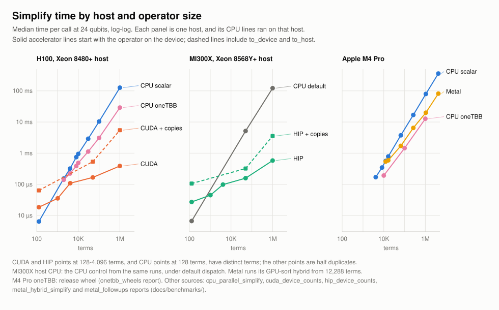
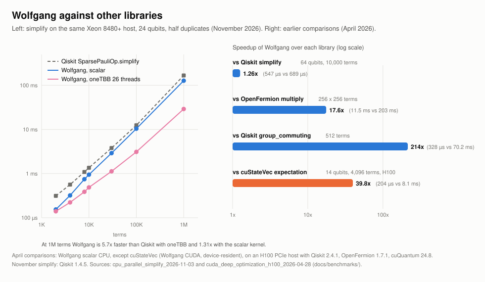
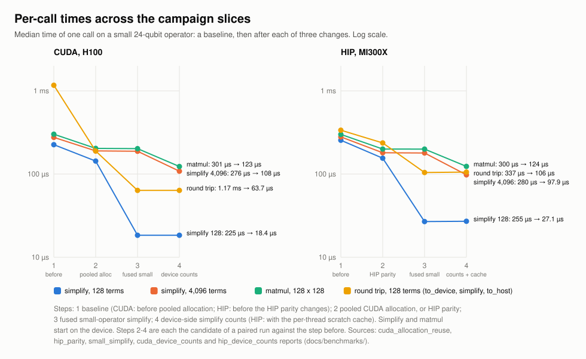
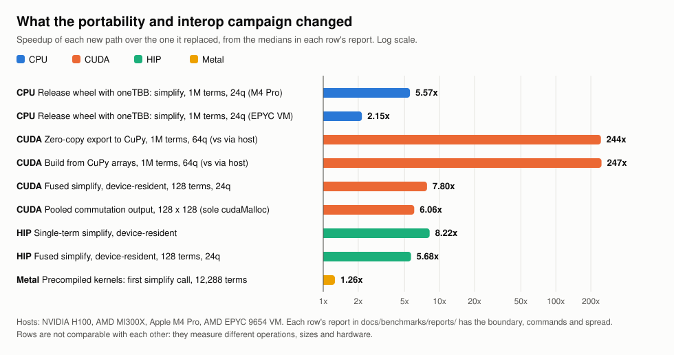

# Benchmark evidence

Wolfgang's performance statements cite the reports in
`docs/benchmarks/reports/`, all listed below. Each report names its hardware, toolchain, commit,
command, timing boundary and limitations, and follows the
[benchmark protocol](protocol.md). A speedup applies to the configuration a
report names, not to every platform or shape.

## Summary figures

`scripts/render_readme_figures.py` draws these from the reports' committed
data; the [performance guide](../user/performance.md#current-results)
discusses them.

## Accelerator follow-ups campaign (November 2026)

Plan: `docs/plans/accelerator_followups_campaign_plan.md`. Review closeout:
`docs/reviews/accelerator_followups_campaign_2026-11-03.md`.

| Report | What it measured |
| --- | --- |
| [Device-side simplify counts](reports/cuda_device_counts_h100_2026-11-03.md) | Simplify and `matmul` waiting for the GPU once instead of eight times on an H100 |
| [HIP device-side counts and cached scratch](reports/hip_device_counts_mi300x_2026-11-03.md) | The same pipeline on an MI300X, and why its scratch needs a per-thread cache |
| [Host transfers through pinned memory](reports/host_transfers_2026-11-03.md) | `to_host` and `to_device` on an H100 and an MI300X, and why page faults dominated large copies |
| [CPU thread cap](reports/cpu_threads_2026-11-03.md) | Simplify under a oneTBB thread cap, with processes sharing cores and inside a CPU quota |

## Portability and interop campaign (November 2026)

Plan: `docs/plans/portability_and_interop_campaign_plan.md`. Review closeout:
`docs/reviews/portability_interop_campaign_2026-11-03.md`.

| Report | What it measured |
| --- | --- |
| [oneTBB in release wheels](reports/onetbb_wheels_2026-11-03.md) | Parallel simplify from pip wheels on an x86 VM and an M4 Pro |
| [Zero-copy device arrays](reports/device_arrays_h100_2026-11-03.md) | Zero-copy export (timed through DLPack, both protocols tested) and device-to-device import on an H100 |
| [Fused small simplify](reports/small_simplify_2026-11-03.md) | One-kernel simplify for small operators on H100 and MI300X |
| [Pooled commutation output](reports/cuda_commutation_pool_h100_2026-11-03.md) | `DeviceCommutationMatrix` from the memory pool on an H100 |
| [Small-operation profile](reports/cuda_small_op_profile_h100_2026-11-03.md) | Nsight Systems breakdown behind the streams-and-graphs decision |
| [HIP parity on MI300X](reports/hip_parity_mi300x_2026-11-03.md) | HIP simplify numeric contract and call overhead |
| [Metal follow-ups](reports/metal_followups_2026-11-03.md) | Parallel reduction, large inputs and precompiled kernels on an M4 Pro |

Each bar compares a new path with the one it replaced, at one boundary; the
rows measure different operations on different hardware and are not
comparable with each other.

## Usability and kernel campaign (November 2026)

| Report | What it measured |
| --- | --- |
| [CPU parallel simplify](reports/cpu_parallel_simplify_2026-11-03.md) | oneTBB simplify against scalar on two x86 hosts |
| [CUDA allocation reuse](reports/cuda_allocation_reuse_h100_2026-11-03.md) | Pooled allocation and cheaper device selection on an H100 |
| [CUDA simplify paths](reports/cuda_simplify_paths_h100_2026-11-03.md) | Simplify path selection on an H100 |
| [Metal hybrid simplify](reports/metal_hybrid_simplify_2026-11-03.md) | GPU sort with CPU reduction on an M4 Pro |
| [Host API](reports/host_api_2026-11-03.md) | Host `PauliSum` boundary additions and commutator timings |

## All reports

By backend, oldest first. Link text is each report's title (early reports predate the project's rename).

### CUDA

- 2026-04-27: [CUDA Evidence - NVIDIA H100 PCIe - 2026-04-27](reports/cuda_phase11_h100_2026-04-27.md)
- 2026-04-28: [CUDA Deep Optimization Report - NVIDIA H100 PCIe - 2026-04-28](reports/cuda_deep_optimization_h100_2026-04-28.md)
- 2026-04-28: [H100 CUDA Deep Optimization Campaign 2](reports/cuda_deep_optimization_h100_campaign2_2026-04-28.md)
- 2026-04-28: [H100 CUDA Deep Optimization Campaign 3](reports/cuda_deep_optimization_h100_campaign3_2026-04-28.md)
- 2026-04-28: [CUDA Nsight Hillclimb - NVIDIA H100 PCIe - 2026-04-28](reports/cuda_h100_nsight_hillclimb_2026-04-28.md)
- 2026-04-28: [CUDA Performance Hardening - NVIDIA H100 PCIe - 2026-04-28](reports/cuda_h100_performance_hardening_2026-04-28.md)
- 2026-04-29: [CUDA Cross-Architecture Campaign 10 Report](reports/cuda_cross_architecture_campaign10_2026-04-29.md)
- 2026-04-29: [H100 CUDA Deep Optimization Campaign 4](reports/cuda_deep_optimization_h100_campaign4_2026-04-29.md)
- 2026-04-29: [H100 CUDA Deep Optimization Campaign 5](reports/cuda_deep_optimization_h100_campaign5_2026-04-29.md)
- 2026-04-29: [H100 CUDA Deep Optimization Campaign 6](reports/cuda_deep_optimization_h100_campaign6_2026-04-29.md)
- 2026-04-29: [CUDA Deep Optimization H100 Campaign 7](reports/cuda_deep_optimization_h100_campaign7_2026-04-29.md)
- 2026-04-29: [CUDA Deep Optimization H100 Campaign 8](reports/cuda_deep_optimization_h100_campaign8_2026-04-29.md)
- 2026-04-29: [CUDA Deferred Headroom Campaign 9 H100 Report](reports/cuda_deferred_headroom_campaign9_2026-04-29.md)
- 2026-04-29: [CUDA Campaign 7 Non-H100 NVIDIA Portability](reports/cuda_portability_campaign7_non_h100_nvidia_2026-04-29.md)
- 2026-04-29: [Campaign 8 Non-H100 NVIDIA Portability Report](reports/cuda_portability_campaign8_non_h100_nvidia_2026-04-29.md)
- 2026-04-29: [CUDA Portability Campaign 9 Non-H100 NVIDIA Report](reports/cuda_portability_campaign9_non_h100_nvidia_2026-04-29.md)
- 2026-04-29: [CUDA Residual-Risk Campaign 11 Report](reports/cuda_residual_risk_campaign11_2026-04-29.md)
- 2026-11-03: [CUDA Allocation Reuse And Call Overhead On H100](reports/cuda_allocation_reuse_h100_2026-11-03.md)
- 2026-11-03: [Pooled CUDA Commutation Output](reports/cuda_commutation_pool_h100_2026-11-03.md)
- 2026-11-03: [CUDA Simplify With Device-Side Counts](reports/cuda_device_counts_h100_2026-11-03.md)
- 2026-11-03: [CUDA Simplify Paths On H100](reports/cuda_simplify_paths_h100_2026-11-03.md)
- 2026-11-03: [CUDA Small-Operation Profile: Streams And Graphs](reports/cuda_small_op_profile_h100_2026-11-03.md)
- 2026-11-03: [Zero-Copy Device Arrays On CUDA](reports/device_arrays_h100_2026-11-03.md)
- 2026-11-03: [Fused Small-Operator Simplify On CUDA And HIP](reports/small_simplify_2026-11-03.md)

### ROCm/HIP

- 2026-04-29: [ROCm MI300X Bring-Up Report](reports/rocm_mi300x_bringup_2026-04-29.md)
- 2026-04-30: [ROCm MI300X Campaign 2 Report](reports/rocm_mi300x_campaign2_2026-04-30.md)
- 2026-04-30: [ROCm MI300X Campaign 3 Report](reports/rocm_mi300x_campaign3_2026-04-30.md)
- 2026-04-30: [ROCm MI300X Campaign 4 Report](reports/rocm_mi300x_campaign4_2026-04-30.md)
- 2026-04-30: [ROCm MI300X Campaign 5 Interop And Execution-Control Report](reports/rocm_mi300x_campaign5_2026-04-30.md)
- 2026-04-30: [ROCm MI300X Campaign 6 Expectation And Matmul Parity Report](reports/rocm_mi300x_campaign6_2026-04-30.md)
- 2026-04-30: [ROCm MI300X Campaign 7 Release-Support Report](reports/rocm_mi300x_campaign7_2026-04-30.md)
- 2026-05-01: [ROCm Campaign 8 Architecture-Readiness Report](reports/rocm_campaign8_architecture_readiness_2026-05-01.md)
- 2026-11-03: [HIP Simplify With Device-Side Counts And Cached Scratch](reports/hip_device_counts_mi300x_2026-11-03.md)
- 2026-11-03: [Accelerator Simplify Parity And HIP Call Overhead](reports/hip_parity_mi300x_2026-11-03.md)

### Apple Metal

- 2026-05-01: [Apple Metal Bring-Up Report - 2026-05-01](reports/apple_metal_bringup_2026-05-01.md)
- 2026-05-05: [Apple Metal Campaign 1 Optimization And Evidence Report](reports/apple_metal_optimization_campaign1_2026-05-05.md)
- 2026-05-05: [Apple Metal Campaign 2 Optimization And Evidence Report](reports/apple_metal_optimization_campaign2_2026-05-05.md)
- 2026-05-06: [Apple Metal Campaign 3 Optimization And Evidence Report](reports/apple_metal_optimization_campaign3_2026-05-06.md)
- 2026-05-06: [Apple Metal Campaign 4 Optimization And Evidence Report](reports/apple_metal_optimization_campaign4_2026-05-06.md)
- 2026-05-06: [Apple Metal Optimization Campaign 5 Report](reports/apple_metal_optimization_campaign5_2026-05-06.md)
- 2026-05-07: [Apple Metal Optimization Campaign 6 Report](reports/apple_metal_optimization_campaign6_2026-05-07.md)
- 2026-05-07: [Apple Metal Optimization Campaign 7 Report](reports/apple_metal_optimization_campaign7_2026-05-07.md)
- 2026-05-07: [Apple Metal Optimization Campaign 8 Report](reports/apple_metal_optimization_campaign8_2026-05-07.md)
- 2026-08-21: [Apple Metal Wave 1D Report](reports/apple_metal_wave1d_2026-08-21.md)
- 2026-11-03: [Metal Hybrid Simplify Follow-Ups](reports/metal_followups_2026-11-03.md)
- 2026-11-03: [Metal Hybrid Simplify](reports/metal_hybrid_simplify_2026-11-03.md)

### CPU and host

- 2026-04-25: [CPU Evidence - Apple Silicon M4 Pro - 2026-04-25](reports/cpu_phase9_apple_silicon_m4_pro_2026-04-25.md)
- 2026-04-25: [CPU Evidence - x86_64 AMD EPYC 9654 - 2026-04-25](reports/cpu_phase9_x86_64_amd_epyc_9654_2026-04-25.md)
- 2026-08-21: [Wave 1B CPU Small-Shape Dispatch Report](reports/cpu_small_shape_dispatch_wave1b_2026-08-21.md)
- 2026-09-21: [Python Boundary Hardening (2026-09-21)](reports/python_boundary_hardening_2026-09-21.md)
- 2026-11-03: [CPU Parallel Simplify With oneTBB](reports/cpu_parallel_simplify_2026-11-03.md)
- 2026-11-03: [CPU Thread Cap](reports/cpu_threads_2026-11-03.md)
- 2026-11-03: [Host API Boundary And Commutator Timings](reports/host_api_2026-11-03.md)
- 2026-11-03: [oneTBB In Release Wheels](reports/onetbb_wheels_2026-11-03.md)

### Cross-backend

- 2026-05-01: [Backend-Neutral Accelerator Campaign 9 Closeout Report](reports/backend_neutral_accelerator_campaign9_2026-05-01.md)
- 2026-11-03: [Host Transfers Through Pinned Memory](reports/host_transfers_2026-11-03.md)

The [research provenance ledger](../research/provenance.md) records the earlier
campaigns with their plans and outcomes, including rejected optimizations.
