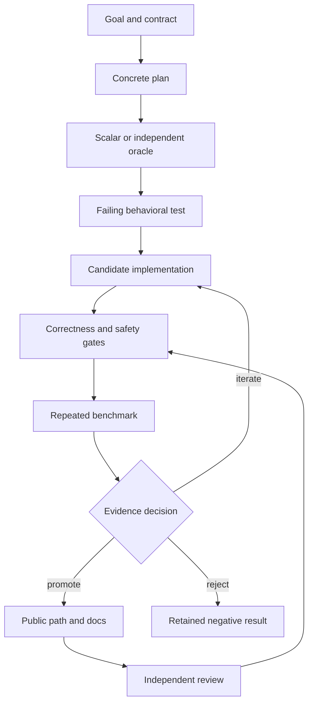

# Agent-driven kernel engineering

Wolfgang uses coding agents as fast collaborators, not as sources of truth. Agents search a broad design space, draft kernels and tests, compare alternatives, orchestrate remote experiments, and perform independent reviews. Only executable evidence can promote a change.

Low-level optimization is prone to failures that look plausible. A kernel can compile and still race. It can return the right answer for only one shape, time the asynchronous launch instead of completion, transfer more data than the baseline, use unsupported instructions, or appear to win because its semantics differ. A fluent generated explanation does not reduce any of these risks.

## The operating loop

### 1. Lock the contract

Before optimizing, the project states:

- exact operator semantics and ordering;
- accepted shape, dtype, layout, and index conventions;
- ownership and lifetime;
- allocation and growth limits;
- synchronization behavior;
- public versus benchmark-only status;
- timing boundary and correctness oracle.

A candidate cannot redefine the problem after measurement.

### 2. Build the oracle first

The portable scalar C++ path is the default structural oracle. Where useful, Qiskit, OpenFermion, dense matrices, or a simpler Python implementation provide independent checks. Property tests cover algebraic identities and generated edge cases.

Agents are instructed to write the failing behavioral test before changing production code. The test then defines what should happen, instead of recording whatever the generated code happens to do.

### 3. Generate narrow candidates

Each candidate targets one bottleneck and one evidence question: a packed commutation lane, threshold, reduction, workspace policy, transfer boundary, or device consumer. Narrow slices make failures attributable and keep rollback cheap.

Multiple agents may independently inspect architecture, security, numerical behavior, and release claims. They do not edit overlapping files concurrently unless they use isolated worktrees and an explicit integration review.

### 4. Verify before timing

A benchmark row is invalid unless correctness passes. Native changes also go through checked-arithmetic, malformed-input, moved-from and lifetime, CPU-only import, and unavailable-backend tests, plus sanitizer or accelerator tooling runs where that tooling is available.

When hardware is unavailable, the project records an external blocker or an explicit skip. It never substitutes invented command output, simulated profiler evidence, or a claim that a successful compile implies runtime support.

### 5. Measure honest boundaries

Accelerator timing names what it includes:

- host-to-device and device-to-host transfer;
- allocation versus output/workspace reuse;
- kernel or command-buffer execution;
- synchronization point;
- compact reduction versus dense materialization;
- pipeline/cache warmup;
- host conversion and Python binding overhead.

Benchmark metadata is allowlisted and sanitized. The project keeps enough environment detail to interpret results without publishing usernames, addresses, hostnames, arbitrary environments, or raw infrastructure databases.

### 6. Promote, iterate, or reject

Promotion requires repeated evidence in a relevant regime and no semantic regression. A candidate that loses stays private or is removed. A candidate blocked by missing hardware or tooling remains unavailable. Negative results are retained so that an attractive but unproductive idea is not rediscovered later without its history.

### 7. Review independently

Fresh reviewers check spec compliance before code quality, then integration, security, and public claims. The implementer does not substitute self-review for independent review. Release-facing changes also verify artifacts from a clean installation, not only from an editable tree.

## Evidence hierarchy

| Level | What it proves | What it does not prove |
|---|---|---|
| Source-inspected | The design is understandable | It compiles or is correct |
| Compile-tested | A named toolchain accepts it | Runtime behavior |
| Runtime-tested | Correctness executes on named hardware | Performance |
| Performance-tested | A scoped timing result is retained | Broad portability |
| Release-supported | Install/runtime evidence is continuously gated | Every future platform |

Accelerated software often collapses all five levels into the single word "supported". Naming them separately keeps each claim at the level its evidence reaches.

## Repository evidence

Each part of the loop leaves a public record:

- `docs/plans/` records concrete implementation and experiment plans;
- `tests/` retains semantic, property, protocol, and packaging contracts;
- `benchmarks/` contains deterministic producers;
- `docs/benchmarks/reports/` records accepted and rejected conclusions;
- `docs/architecture/` defines ownership, support, and synchronization;
- `docs/research/provenance.md` routes detailed campaign history;
- `scripts/validate.py` turns project policy into executable gates;
- `AGENTS.md` gives automated contributors the same source-of-truth map.

Raw profiler captures and private infrastructure records are not part of the public evidence. What the repository publishes is the reproducible chain from contract to code, test, environment, measurement, and decision, not a volume of unfiltered logs.

## Why this scales

Agents raise implementation throughput and the number of hypotheses the project can consider. The evidence loop keeps that throughput from turning into unreviewed complexity. Small plans, isolated worktrees, test-first behavior, promotion thresholds, independent review, and explicit stopping reasons let another engineer audit the process.

Agent speed stays subordinate to numerical correctness, hardware reality, privacy, and release discipline.
