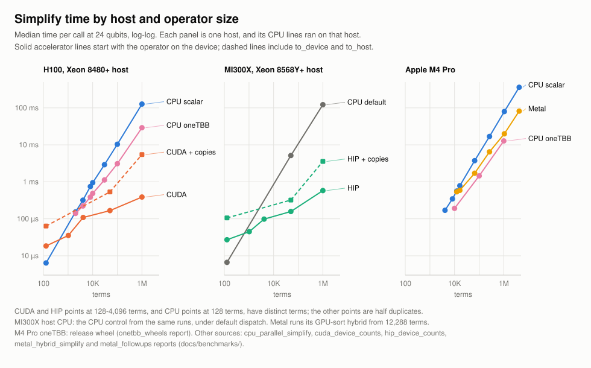

# Wolfgang

**Packed Pauli algebra with a portable CPU reference and measured accelerator kernels.**

Wolfgang stores sparse sums of Pauli strings as pairs of bit masks with complex coefficients. One representation serves the scalar CPU reference, the SIMD and oneTBB kernels chosen at run time (release CPU wheels built after `v0.2.3` bundle oneTBB), the CUDA, ROCm/HIP and Apple Metal backends in source builds, and conversions to Qiskit, OpenFermion and CUDA-Q. CUDA operators share their device buffers with CuPy and PyTorch without a copy.

```python
import numpy as np
from wolfgang_quantum import PauliSum

hamiltonian = PauliSum.from_labels(
    ["XX", "YY", "ZI", "IZ"],
    np.array([0.5, 0.5, -1.0, -1.0], dtype=np.complex128),
)

reduced = (hamiltonian @ hamiltonian).simplify()
print(reduced.to_labels())
```

## Performance

[](benchmarks/plots/simplify_by_backend.svg)

Simplify runs on every backend. Small operators belong on the CPU: at 128 terms the scalar kernel takes 6.4 us and a device-resident H100 call 18 us. At 1M terms the H100 takes 0.39 ms (5.5 ms including copies) against 29 ms for oneTBB on its host. The [performance guide](user/performance.md) adds comparisons with Qiskit, OpenFermion and cuStateVec and shows how per-call times changed across campaigns.

## How the project works

Each optimization follows the same loop:

1. fix the exact algebraic semantics in a scalar C++ implementation;
2. expose them through a small Python API;
3. add property tests and cross-library oracles;
4. optimize one operation at one timing boundary;
5. keep the hardware and toolchain evidence in a report;
6. drop the optimization, or the public API, when the evidence does not support it.

The repository is a usable library and a record of agent-assisted systems work. Agent output never counts as evidence by itself: code, tests, builds, profilers and independent review decide what is accepted.

## Explore

- [Install Wolfgang](getting-started/installation.md)
- [Run the quickstart](getting-started/quickstart.md)
- [Understand the packed representation](guide/architecture.md)
- [Read the accelerator support boundary](accelerators/overview.md)
- [Browse the benchmark evidence](benchmarks/index.md) and [protocol](benchmarks/protocol.md)
- [Read the semantic contracts](architecture/semantic_contracts.md)
- [Check the current release matrix](release/support_matrix.md)

!!! warning "Accelerator packaging"
    Default wheels are portable CPU builds; those built after `v0.2.3` bundle oneTBB. The CUDA, ROCm/HIP and Metal backends need a source build, and no accelerator wheel is published.
