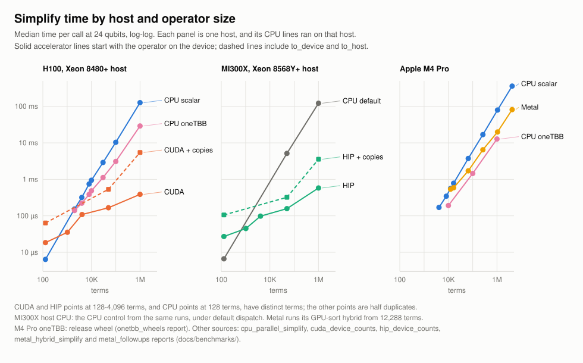
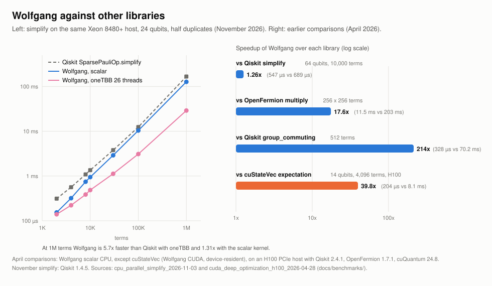
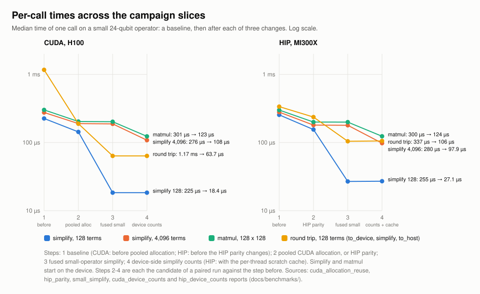

# Performance

Every build includes the portable scalar CPU backend. Optional SIMD (AVX2,
AVX-512, NEON) backends cover pairwise commutation and full grouping-graph
construction, and oneTBB covers both of those and simplify; release CPU wheels
built after `v0.2.3` include oneTBB. CUDA, ROCm/HIP and Apple Metal source builds add
device-resident operations on `DevicePauliSum`, listed per backend in the
[accelerator overview](../accelerators/overview.md).

## Current Results

The figures below are drawn from committed benchmark data by
`scripts/render_readme_figures.py`. Each number comes from a report that names
its hardware, build, baseline and spread; the
[benchmark evidence index](../benchmarks/index.md) lists every report.

### Simplify on each backend

[](../benchmarks/plots/simplify_by_backend.svg)

Simplify merges duplicate terms and drops negligible ones, and every backend
implements it. Each panel is one host, so the CPU lines ran beside the
accelerator they are compared with. At 128 terms a device-resident simplify
takes 18 us on the H100 and 27 us on the MI300X, against 6.4 us for the scalar
CPU kernel, so small operators belong on the CPU. At 1M terms (24 qubits, half
duplicates):

| Host | Accelerator, device-resident | Accelerator, with copies | CPU |
| --- | ---: | ---: | --- |
| H100, Xeon 8480+ (26 vCPUs) | 0.39 ms | 5.5 ms | 29 ms oneTBB, 127 ms scalar |
| MI300X, Xeon 8568Y+ | 0.58 ms | 3.6 ms | 122 ms (default dispatch) |
| Apple M4 Pro | 19.9 ms (Metal hybrid) | not measured | 12.8 ms oneTBB, 80 ms scalar |

"With copies" times `to_device()`, `simplify()` and `to_host()` together. On
the M4 Pro the Metal hybrid beats the scalar kernel but not oneTBB.

### Against other libraries

[](../benchmarks/plots/wolfgang_vs_other_libraries.svg)

On the same Xeon host, Wolfgang's simplify is 1.3x faster than Qiskit 1.4.5's
`SparsePauliOp.simplify` at 1M terms with the scalar kernel and 5.7x faster
with oneTBB
([CPU parallel simplify](../benchmarks/reports/cpu_parallel_simplify_2026-11-03.md)).
The comparisons on the right were measured in April 2026 on an H100 PCIe host
([CUDA deep optimization](../benchmarks/reports/cuda_deep_optimization_h100_2026-04-28.md)):
multiplication of two 256-term operators 17.6x faster than OpenFermion,
commuting groups of 512 terms 214x faster than Qiskit, and a device-resident
expectation of a 4,096-term operator on a 14-qubit statevector 39.8x faster
than computing one cuStateVec expectation per term and combining them on the
host.

### Per-call times across campaigns

[](../benchmarks/plots/call_time_by_slice.svg)

Small GPU calls were dominated by allocation, synchronization and launches
rather than arithmetic. Pooled device allocation on CUDA, the HIP parity
changes, and a fused kernel for operators of up to 1,024 terms took a 128-term
simplify from 225 to 18.4 us on the H100 and from 255 to 27.1 us on the
MI300X. Keeping simplify's counts on the device then took 4,096 terms from 188
to 108 us on the H100 and from 182 to 98 us on the MI300X. Where launch and synchronization still dominate is profiled in the
[small-operation profile](../benchmarks/reports/cuda_small_op_profile_h100_2026-11-03.md).

### Recent changes

Headline measurements from the last two campaigns, the latest campaign first:

| Change | Measured | Report |
| --- | --- | --- |
| CUDA simplify above the fused kernel keeps its counts on the device, 4,096 terms | 188.2 to 108.3 us on an H100; `matmul` of 128 x 128 terms 202.0 to 123.3 us | [CUDA device counts](../benchmarks/reports/cuda_device_counts_h100_2026-11-03.md) |
| HIP simplify on the same pipeline with cached scratch blocks, 4,096 terms | 181.7 to 97.9 us on an MI300X; 1M terms 1.556 to 0.579 ms | [HIP device counts](../benchmarks/reports/hip_device_counts_mi300x_2026-11-03.md) |
| `to_host` through pinned staging, 1M terms, 24 qubits | 14.8 to 5.52 ms on an H100; 13.8 to 6.41 ms on an MI300X | [host transfers](../benchmarks/reports/host_transfers_2026-11-03.md) |
| `set_num_threads(4)` inside a 4-CPU quota, simplify of 500,000 terms on 26 vCPUs | mean 27.8-28.4 to 22.5-22.6 ms, 90th percentile 59.4-61.4 to 22.7-22.8 ms; median 14.5-14.6 to 22.4-22.5 ms | [CPU threads](../benchmarks/reports/cpu_threads_2026-11-03.md) |
| oneTBB in release wheels, simplify of 1M terms (24 qubits, no duplicates) | 141 to 65.4 ms on a 16-vCPU x86 VM; 70.7 to 12.7 ms on an M4 Pro | [oneTBB wheels](../benchmarks/reports/onetbb_wheels_2026-11-03.md) |
| Fused small simplify, device-resident, 128 terms, 24 qubits | 143.5 to 18.4 us on an H100; 152.7 to 26.9 us on an MI300X | [small simplify](../benchmarks/reports/small_simplify_2026-11-03.md) |
| Zero-copy export of a 1M-term, 64-qubit CUDA operator to CuPy | 8.83 ms through the host to 36.2 us on an H100 | [device arrays](../benchmarks/reports/device_arrays_h100_2026-11-03.md) |
| Building a CUDA operator from CuPy arrays, 1M terms, 64 qubits | 20.7 ms through the host to 83.7 us on an H100 | [device arrays](../benchmarks/reports/device_arrays_h100_2026-11-03.md) |
| Pooled `commutes_with_device` output, 128 x 128 | 64.1 to 10.6 us on an H100 when its output was the only `cudaMalloc` buffer; about 1.14x when another was live | [pooled commutation](../benchmarks/reports/cuda_commutation_pool_h100_2026-11-03.md) |
| HIP single-term simplify, device-resident | 254.5 to 31.0 us on an MI300X | [HIP parity](../benchmarks/reports/hip_parity_mi300x_2026-11-03.md) |
| Metal precompiled kernels, first simplify call (12,288 terms, warm shader cache) | 3.89 to 3.08 ms on an M4 Pro | [Metal follow-ups](../benchmarks/reports/metal_followups_2026-11-03.md) |

## Backend Selection

The runtime backend selector is controlled by `WOLFGANG_CPU_BACKEND`.

```bash
WOLFGANG_CPU_BACKEND=auto python benchmarks/bench_cpu_dispatch.py --smoke --repeat 1
WOLFGANG_CPU_BACKEND=scalar python benchmarks/bench_cpu_dispatch.py --smoke --repeat 1
```

Supported selectors:

```text
auto
scalar
tbb
avx2
avx512
neon
sve
```

`scalar` forces the portable baseline. The optimized selectors fail clearly
unless the corresponding backend was compiled and the current CPU supports it.
`auto` uses optimized kernels only where Wolfgang has coverage and benchmark
evidence:

```text
large pairwise commutation (from 331,776 entries; from 2048 x 2048 for one-word
  operators on AVX2 or AVX-512): oneTBB when compiled and at least 3 threads are
  available (2 when no SIMD kernel covers the operator), each thread running the
  best SIMD kernel; otherwise AVX-512, AVX2, NEON, or scalar
full grouping graph construction: AVX-512, AVX2, NEON, or scalar
simplify (including inside matmul, commutator and equiv): oneTBB from 8,192 terms
  when compiled and at least 2 threads are available, otherwise scalar
all other kernels: scalar
```

Operations outside this list run the scalar kernel under `auto` and
`scalar`; a forced optimized selector raises for them.

## Build Metadata

`wolfgang_quantum._wolfgang_core._build_info()` reports backend state:

```python
import wolfgang_quantum._wolfgang_core as core

info = core._build_info()
assert info["active_cpu_backend"] == "scalar"
assert "scalar" in info["available_cpu_backends"]
print(info["optimized_cpu_kernels"])
```

Benchmark reports include:

```text
active CPU backend
requested CPU backend
compiled CPU backends
available CPU backends
unavailable backend reasons
CPU model and architecture
CPU instruction-set probe source or unavailable reason
compiler and CMake versions
CMake CPU options and compiled backend feature flags
compiler CPU flags reported through the build or environment
thread settings
oneTBB status
optimized CPU kernel coverage
CUDA status
```

## Benchmark Commands

Run the local smoke suite through the validation entrypoint:

```bash
python scripts/validate.py
```

Run the dispatch benchmark directly:

```bash
python benchmarks/bench_cpu_dispatch.py --smoke --repeat 1 --json
```

Run operation-specific benchmark smokes:

```bash
python benchmarks/bench_simplify.py --smoke --repeat 1 --json
python benchmarks/bench_multiply.py --smoke --repeat 1 --json
python benchmarks/bench_grouping.py --smoke --repeat 1 --json
python benchmarks/bench_expectation.py --smoke --repeat 1 --json
python benchmarks/bench_cuda_kernels.py --smoke --repeat 1 --json
python benchmarks/bench_competitive_baselines.py --smoke --repeat 1 --json
```

Do not treat benchmark smoke timings as performance claims. They prove that the
benchmark protocol runs and records metadata. Performance claims require a
dedicated run on named hardware, with scalar and optimized paths compared only
where the optimized paths are compiled and available.

## CPU Hardening Checkpoint

Before CUDA work began, a CPU hardening checkpoint optimized the scalar hot
paths and recorded before-and-after evidence for:

```text
simplify and canonical duplicate reduction across low- and high-duplicate regimes
Pauli-sum multiplication, including default simplified output under duplicate pressure
pairwise commutation and grouping
statevector expectation, including all-diagonal statevector workloads
diagonal Z-count expectation
optional Qiskit and OpenFermion competitive baselines when installed
```

Hardening benchmarks must keep correctness checks enabled for the measured
datasets. A result is rejected if it removes reference comparisons, changes
public APIs, alters coefficient semantics, weakens ordering guarantees, or
implies optimized or GPU coverage beyond the kernels, build configurations and
hardware that were compiled, validated and benchmarked.

Run the combined CPU hardening suite with:

```bash
python benchmarks/bench_cpu_hardening.py --profile default --repeat 3 --warmup 1 --json
```

`--profile smoke` is a quick validation run and `--profile stress` collects
broader CPU evidence.

Run competitive baselines with optional dependencies installed:

```bash
python benchmarks/bench_competitive_baselines.py --repeat 3 --warmup 1 --json
```

The competitive benchmark records an unavailable library as unavailable and
never substitutes a synthetic comparison. The comparable baselines are Qiskit
`SparsePauliOp` simplify and grouping and OpenFermion `QubitOperator`
multiplication. Each case records whether the competitor's result was checked
for correctness and, for OpenFermion, the canonical operand sizes used in the
timed multiplication.

## Benchmark Plots

Plots are generated from committed benchmark data, never from ad hoc local
timings. The three figures in [Current Results](#current-results) and the
README come from:

```bash
python scripts/render_readme_figures.py
```

`tests/test_readme_figures.py` runs it with `--check` and fails when a
committed figure no longer matches the data. The portability campaign's
`portability_campaign_speedups.svg`, which compares each new path with the one
it replaced, comes from:

```bash
python scripts/render_portability_campaign_assets.py
```

Earlier CUDA campaigns each rendered their own figures. Campaign 10's
landscape adds A100 and RTX PRO 6000 Blackwell source-build evidence, PyTorch
DLPack coverage, and the final grouping, stream/graph and CSR scatter
decisions to Campaign 9's comparison rows:

```bash
python scripts/render_cuda_campaign10_assets.py \
  --data-dir docs/benchmarks/data/cuda_cross_architecture_campaign10_2026-04-29 \
  --plot-dir docs/benchmarks/plots
python scripts/render_cuda_campaign9_assets.py \
  --data-dir docs/benchmarks/data/cuda_deferred_headroom_campaign9_2026-04-29 \
  --plot-dir docs/benchmarks/plots
python scripts/render_cuda_campaign8_assets.py \
  --data-dir docs/benchmarks/data/cuda_deep_optimization_h100_campaign8_2026-04-29 \
  --plot-dir docs/benchmarks/plots
python scripts/render_cuda_campaign7_assets.py \
  --data-dir docs/benchmarks/data/cuda_deep_optimization_h100_campaign7_2026-04-29 \
  --plot-dir docs/benchmarks/plots
python scripts/render_cuda_campaign6_assets.py \
  --data-dir docs/benchmarks/data/cuda_deep_optimization_h100_campaign6_2026-04-29 \
  --plot-dir docs/benchmarks/plots
```

The Campaign 10 landscape plots CPU scalar, every optimized CPU selector that
report captured for the operation, and CUDA transfer-inclusive and
device-resident timings, plus operator-resident, device-output, compact
consumer, CuPy consumer and external-package points where the operation has
those boundaries. Its speedups are relative to CPU scalar on the same
deterministic dataset, and it is source-build evidence for the named hardware
and report revision only.

## SIMD And oneTBB

Explicit SIMD and oneTBB are optional compiled backends. They keep the scalar
baseline available (`WOLFGANG_CPU_BACKEND=scalar`) and are reported as
unavailable when the compiler, package, or hardware support is absent. Release
CPU wheels bundle oneTBB, so `auto` picks it there for simplify and large
pairwise commutation on hosts with at least four oneTBB threads
(`docs/benchmarks/reports/onetbb_wheels_2026-11-03.md`). oneTBB does not
support `fork()`: in a process forked after a oneTBB kernel ran (for example
a `multiprocessing` fork pool), Wolfgang runs the bit-identical scalar or SIMD
kernels instead, and `WOLFGANG_CPU_BACKEND=tbb` raises. Use the `spawn` or
`forkserver` start method to keep oneTBB in workers.

By default oneTBB uses every hardware thread the process may run on, and it
counts the cores the affinity mask allows, not a container's CPU quota.
`wolfgang_quantum.set_num_threads(n)` or `WOLFGANG_NUM_THREADS=n` caps it, and
`get_num_threads()` reports the current count. Measured on a 26-vCPU host
(`docs/benchmarks/reports/cpu_threads_2026-11-03.md`):

- inside a 4-CPU quota, a cap of 4 made simplify 1.25x faster on average and
  its 90th-percentile time 2.6x shorter, because uncapped oneTBB started 26
  threads and was throttled; the median call was slower (22.4 against
  14.5 ms), so the cap trades the best case for steady calls;
- four uncapped processes sharing the cores ran as fast as four capped ones;
  oneTBB tolerated the oversubscription;
- eight processes capped at three threads each were slower than eight
  uncapped ones, because auto dispatch then required four threads for oneTBB.
  It now needs two for simplify (`docs/benchmarks/reports/cpu_thread_floor_2026-11-03.md`).

Use the cap for CPU quotas and to leave cores for other work. Two oneTBB threads
beat scalar simplify on every host measured, including one core's two
hyperthreads; a cap of one gives single-threaded execution.

Optimized kernels:

```text
oneTBB: commutes_with, full_group_commutation_graph, simplify
AVX2: commutes_with_words_1_2, full_group_commutation_graph_words_1_2
AVX-512: commutes_with_words_1_2, full_group_commutation_graph_words_1_2
NEON: commutes_with_words_1_2, full_group_commutation_graph_words_1_2
```

Use `benchmarks/bench_cpu_dispatch.py` to compare `auto`, forced scalar, and
every compiled optimized selector on the same deterministic datasets. Use
`benchmarks/bench_cpu_thresholds.py` to characterize the large pairwise
commutation threshold where `auto` may switch to oneTBB.

A forced optimized selector raises for a scalar-only operation rather than
running scalar code under its name. Forced SIMD selectors also raise for
commutation outside the one- and two-word packed widths they cover. `auto`
falls back to scalar for those operations and widths.

`auto` uses oneTBB for large dense pairwise commutation, where the thread
overhead is amortized. Full graph construction is available as a forced
oneTBB path, but `auto` prefers SIMD or scalar for it because oneTBB's
overhead did not pay off on the Phase 9 hardware.

## Apple Silicon And x86_64

Apple Silicon and x86_64 results are reported separately. Apple Silicon
results count as full CPU evidence for portability and baseline timing; an
x86-specific optimization claim needs x86_64 results.

## CUDA Source-Build Kernels

CUDA is enabled at source-build time:

```bash
WOLFGANG_VALIDATE_CUDA=1 WOLFGANG_CUDA_ARCHITECTURES=90 python scripts/validate.py
python benchmarks/bench_cuda_kernels.py --profile default --repeat 3 --warmup 1 --json
python benchmarks/bench_cuda_scaling.py --profile default --repeat 3 --warmup 1 --json
```

Validated CUDA kernel coverage:

```text
DevicePauliSum.simplify
DevicePauliSum.expectation_statevector
DevicePauliSum.commutes_with
DevicePauliSum.commutes_with_device
DeviceCommutationMatrix.count_commuting
DeviceCommutationMatrix.conflict_degrees
DeviceCommutationMatrix.__dlpack__
DevicePauliSum.matmul
DevicePauliSum.device_arrays
DevicePauliSum.from_device_arrays
```

For repeated dense commutation that keeps the result on the GPU, allocate the
experimental device-output matrix once and reuse it:

```python
import wolfgang_quantum

lhs_d = lhs.to_device(device=0)
rhs_d = rhs.to_device(device=0)

out = wolfgang_quantum.DeviceCommutationMatrix.empty(
    (lhs_d.num_terms, rhs_d.num_terms),
    device=lhs_d.device,
)
same = lhs_d.commutes_with_device(rhs_d, output=out)
assert same is out

cuda_view = out.__cuda_array_interface__
total_commuting = out.count_commuting()
row_counts = out.count_commuting(axis=1)
col_counts = out.count_commuting(axis=0)
total_conflicts = out.conflict_degrees()
row_conflicts = out.conflict_degrees(axis=1)
col_conflicts = out.conflict_degrees(axis=0)
dlpack_device = out.__dlpack_device__()
flags = out.to_host()
```

`DeviceCommutationMatrix` owns a dense row-major `uint8` CUDA buffer holding
`1` for commuting pairs and `0` for anticommuting pairs. `to_host()` copies it
to the host as a NumPy bool matrix. `count_commuting(axis=None|0|1)` and
`conflict_degrees(axis=None|0|1)` reduce on the device and copy only the
`uint64` counts to the host. `__dlpack__` exports a read-only dense `uint8`
view to CUDA DLPack consumers such as CuPy. A benchmark of this API must
report device-output allocation, device-output reuse, CUDA Array Interface
export, DLPack export and consumer time, the compact reductions, and the
`to_host()` copy separately.

CUDA benchmark reports include CPU scalar, CUDA transfer-inclusive and CUDA
device-resident timings, toolkit, runtime, driver and device metadata, the
compiled CUDA architectures, and the active CPU backend. Tiny smoke cases are
expected to be faster on the CPU and bound by transfers; the default and
stress profiles find the sizes where keeping operands and statevectors on the
GPU pays off. `benchmarks/bench_cuda_scaling.py` sweeps sizes beyond the fixed
profiles for scaling studies. Its `extreme` profile is reserved for hardware
evidence runs because it runs large correctness-checked CPU references and
dense CUDA outputs. All of these are source-build claims; CUDA wheels remain
unavailable until the release and packaging policy changes.

Public CUDA APIs use the default stream and synchronize before returning.
Stream-aware and asynchronous APIs wait for an API review that settles
ownership, events, Python lifetimes and error propagation. Public bit-packed
commutation output is deferred as well: dense `uint8` output serves CUDA Array
Interface consumers, and no capacity or bandwidth need for a packed layout has
been shown. For repeated dense commutation,
`DevicePauliSum.commutes_with_into(other, output)` fills a caller-owned
one-dimensional NumPy bool array, so it can be timed apart from the allocation
inside `DevicePauliSum.commutes_with(other)`.

### CUDA campaign history

The April 2026 H100 campaigns followed `docs/plans/cuda_deep_optimization_plan.md`.
Their decisions still hold:

- Campaign 10 (`docs/benchmarks/reports/cuda_cross_architecture_campaign10_2026-04-29.md`)
  closed every Campaign 9 headroom item. It added A100 `sm_80` and RTX PRO 6000
  Blackwell `sm_120` source-build evidence and PyTorch DLPack consumption of
  `DeviceCommutationMatrix`, kept `conflict_degrees(axis=None|0|1)` as the
  public compact summary, and rejected a public grouping API, public stream
  and CUDA Graph replay (launch overhead was not dominant), and reopening CSR
  scatter (the retained compact consumers do not need full edge lists).
- Campaign 9 (`docs/benchmarks/reports/cuda_deferred_headroom_campaign9_2026-04-29.md`,
  plan `docs/plans/h100_deep_optimization_campaign9_plan.md`) recorded
  privileged Nsight Compute counters and CuPy DLPack export coverage.
- Campaign 8 (`docs/benchmarks/reports/cuda_deep_optimization_h100_campaign8_2026-04-29.md`)
  built private, benchmark-only compact graph and grouping consumers over
  `DeviceCommutationMatrix`. Its decision records,
  `docs/plans/cuda_fused_grouping_public_api_campaign8_review.md`,
  `docs/plans/cuda_dlpack_interop_campaign8_review.md` and
  `docs/plans/cuda_graphs_stream_campaign8_decision.md`, each kept the public
  surface deferred.
- Campaign 7 (`docs/benchmarks/reports/cuda_deep_optimization_h100_campaign7_2026-04-29.md`)
  built private, benchmark-only fused CSR graph export, conflict-degree
  summaries and grouping summaries; the API review is
  `docs/plans/cuda_fused_commutation_consumer_api_review.md`.
- Campaign 6 added `count_commuting(axis=None|0|1)`, CuPy CUDA Array Interface
  consumer comparisons, and Nsight Systems, Nsight Compute and Compute
  Sanitizer evidence; it did not keep a packed-output prototype.
- The earlier Nsight hillclimb recorded rejected CUDA experiments, CPU `perf`
  and x86 SIMD A/B runs. Its retained change sped up forced AVX2 and AVX-512
  commutation stores; oneTBB stayed the preferred large dense pairwise CPU
  selector on that x86 host.

The November 2026 campaigns then went after per-call overhead: pooled
allocation, the fused small-operator kernel, device-side simplify counts and
pinned device-to-host staging (see [Recent changes](#recent-changes)).
Remaining candidates are a fused kernel for operators of roughly 1K to 64K
terms, where simplify still launches the multi-stage pipeline; more
portability lanes such as `sm_86` or `sm_89`; non-H100 Nsight Compute counters
where `ncu` is available; and a specific consumer with a written API and
memory-ownership contract.

## GPU Library Baselines

Wolfgang should benchmark against GPU quantum libraries where they expose the
same workload semantics:

```text
cuQuantum cuStateVec: statevector Pauli expectation with the same statevector, Pauli strings, dtype, and transfer boundary
cuQuantum cuPauliProp: Pauli-expansion sort, deduplication, trace, or propagation-style workloads with exact mapping
CUDA-Q: end-to-end spin-operator observe workflows, including framework and kernel execution costs by design
Qiskit Aer GPU or Aer cuStateVec: framework-level circuit/statevector workflows when installed with GPU support
cuDensityMat and other GPU libraries: future candidates only after a workload-specific mapping is documented
```

GPU-library baselines do not replace Wolfgang's CPU scalar, optimized CPU and
native CUDA timings. Reports must label whether a competitor
timing is framework-level, transfer-inclusive primitive, or device-resident
primitive, and must emit explicit unavailable statuses when an optional GPU
library is absent or not GPU-enabled.
